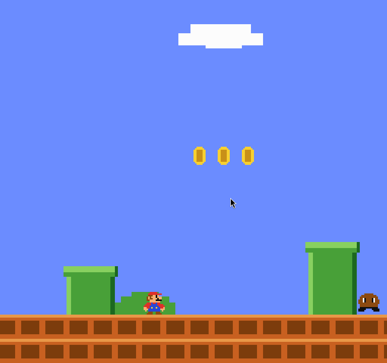

# OmaRio

A Super Mario Bros style platformer you play straight from the Omarchy bar.



## Install

```bash
omarchy plugin add https://github.com/alexwest1981/omario --enable
```

The **M** button then appears in the bar (right section, by default). Move it
with the bar settings if you want it somewhere else.

## Remove

```bash
omarchy plugin remove io.github.alexwest1981.omario --yes
```

Removing takes the folder out of `~/.config/omarchy/plugins/` and drops it from
`shell.json`, so nothing is left behind. The plugin writes no files at all — no
save games, no config, no cache.

## Play

Click the **M** in the bar to open the panel. The game keeps running while the
panel is open and pauses by itself when it closes.

| key | action |
|---|---|
| `←` `→` or `A` `D` | walk |
| `Space` / `↑` / `W` / `X` | jump (hold for a higher jump) |
| `Shift` | run, and throw a fireball when Mario is fiery |
| `P` | pause |
|| `R` | restart from 1-1 |
|| `Esc` | close the panel |

The game opens on Toad's screen — he tells you where the princess is — and the
first jump starts the run.

## The thirty-two courses

A course is data: `level1()`..`level32()` return ground spans, pipes, blocks,
stairs, goombas and koopas (column lists), coins, decor and a flag column, and
`LEVELS` is the order they are played in — eight worlds of four. Adding one is
a function and an entry in that list. Clearing a flagpole runs the clear
animation and then hands over to the next course with score and lives kept.

Every world is three courses and a castle. A castle has Bowser on the bridge,
and the **axe** past him cuts it: that ends the castle the way a flagpole ends
a course, and on the last course in `LEVELS` it ends the game.

| world | what it is |
|---|---|
| 1 | the ground courses: 1-1 the original layout, 1-2 pipes and brick corridors, 1-3 the athletic one with ground islands, 1-4 the castle |
| 2 | more pipes and wider block runs, a brick corridor before the castle |
| 3 | athletic: floating brick platforms over the gaps, little ground under them |
| 4 | long staircases and stacked shelves, a lava bridge before the castle |
| 5 | tight corridors between pipes, coin bricks over the pits |
| 6 | high shelves and short gaps, the castle rebuilt to 1-4's proportions |
| 7 | staircase after staircase, and a castle with Bowser mid-bridge |
| 8 | the hardest of them: stacked shelves, tall pipes, and 8-4 ends the game |

Enemies come in two kinds. A **goomba** is squashed by a stomp. A **koopa** is a
tile and a half tall and leaves its **shell** behind when stomped; walk into
that shell and it slides away faster than Mario can run, taking out whatever it
meets on the way (500 points each), until it hits a wall and comes back. Landing
on a sliding shell stops it again, and a sliding shell hurts on contact. After a
stomp the shell is harmless for a fifth of a second, so the shell you just
landed on does not hurt you while you are still on it.

Scoring follows the original's chain: enemies taken out in one air run pay 100,
200, 400, 500, 800, 1000, 2000, 4000, 5000 and 8000, and the eleventh is a free
life. Touching the ground ends the chain. A hundred coins is also a free life.

Stomp a goomba (+100), collect a coin (+200), bump a ? block (+200), break a
brick as big Mario (+50), reach the flagpole (+1000 and 10 per unit of time
left). Three lives; the clock runs at 2.5 units per second from 400 and an empty
clock costs a life.

The one mushroom block in each course makes Mario big: with it he survives one
hit (shrinking instead of dying) and can break bricks from below. Bumping a coin
brick pays a coin; the mushroom slides out of its block before it walks.

The block gives a **mushroom** to a small Mario and a **fire flower** to a big
one, so the power-up you get depends on what you already are. The flower makes a
small Mario big and a big Mario **fiery**: he turns white-and-red and throws
fireballs with the run button, two at most in the air at once. A fireball leaves
faster than he can run, bounces along the ground, dies against a wall or after
two seconds, and takes an enemy out for 200. A hit costs fire first, then the
size, and only then a life; the power-up carries into the next course but not
through a death.

Two more blocks sit in 1-1 next to the mushroom run. One holds a **starman**:
ten seconds in which nothing can touch Mario — a hit is ignored, everything he
walks into is taken out on the stomp chain, and even Bowser goes (5000, the one
thing that takes him down) — shown by a blinking Mario and a flashing star, and
ended only by the clock. The other holds a **1-up mushroom**: a green-capped
mushroom worth one extra life and no size. The star skips along faster than a
mushroom and bounces off the ground like a fireball.

**Bowser** patrols two tiles either way on the bridge and cannot be stomped —
landing on him costs a life like any other touch. Touching the axe past him ends
the game: Bowser goes down and the princess is rescued (jump on Toad's screen to
start, `R` to play again from 1-1).

## Layout of the code

| file | what it is |
|---|---|
| `Mario.js` | the whole game: level data, physics, collision, enemies, scoring. No rendering. |
| `Art.js` | every sprite: characters are pixel maps (one character per pixel, run-length merged into rectangles) and the tiles are placed rectangles. |
| `GameView.qml` | the playfield: 256x240 level pixels scaled 3x, drawn as rectangles. |
| `BarWidget.qml` | the bar button, the popup card, the HUD, the game loop and key handling. |
| `MarioSprite.qml` | draws one sprite (a fixed number of rect slots) from an art list. |

Two things are worth knowing before editing:

* **The game state is one plain JS object.** Mutating it does not notify QML
  bindings, so every binding that shows live state reads `rev` itself, first
  thing (bumped once per step). Not through a helper property: a `var` property
  that wraps game state returns the same object every frame, so QML sees no
  change and never notifies the binding that uses it. The HUD gets away with
  `root.hud` only because it builds a fresh object each time.
* **No canvas and no textures.** Everything is rectangles, so the level can be
  as long as it likes: the static tiles never re-evaluate their art, and only
  `rev`-reading bindings (mario, enemies, items, blocks) do work per frame.

## Tests

```bash
node tests/mario.test.js     # 56 checks: physics, blocks, enemies, koopas and shells, the fire flower and fireballs, the starman and the 1-up, scoring, courses, fuzz, fixed timestep, art
node tests/view.test.js      # 3 checks: every live binding in GameView.qml reads `rev`
```

`view.test.js` guards a trap that has bitten once: a binding whose only
dependency is an intermediate `var` property never re-evaluates, because the
property returns the same object every frame and QML then sends no notify. The
symptom was goombas and coins drawn at their spawn positions while the game kept
moving them, so an enemy you cannot see kills you.

`Mario.js` carries a `.pragma library` first line for QML; the test strips it and
loads the file in its own `vm` context, so the exact same game code runs under
node.

The last check plays the whole game with a small bot — hold right, jump at a
wall, a hole, an enemy or Bowser — and fails unless the run visits all
thirty-two courses in order and ends on the axe in 8-4. Enemies are switched off in that check: it
measures the courses' geometry (holes, platforms, the castle, the axe and the
hand-over between courses), not the enemy collisions, which have their own
checks. It is what caught a platform in 1-3 that could not be reached and a
patrol of Bowser's that covered the axe.

## Dependencies and assets

None. No network access, no external commands, nothing to install beyond
Omarchy itself. Every sprite is drawn from rectangles defined in `Art.js`, which
is also why the plugin has no Nintendo artwork in it: the level, the cast and
the sprites are original, written for this plugin.

## License

MIT — see [LICENSE](LICENSE).
